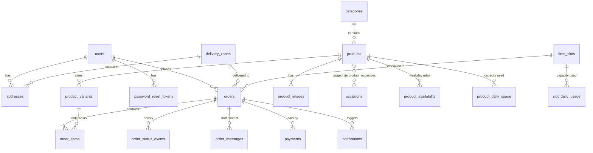
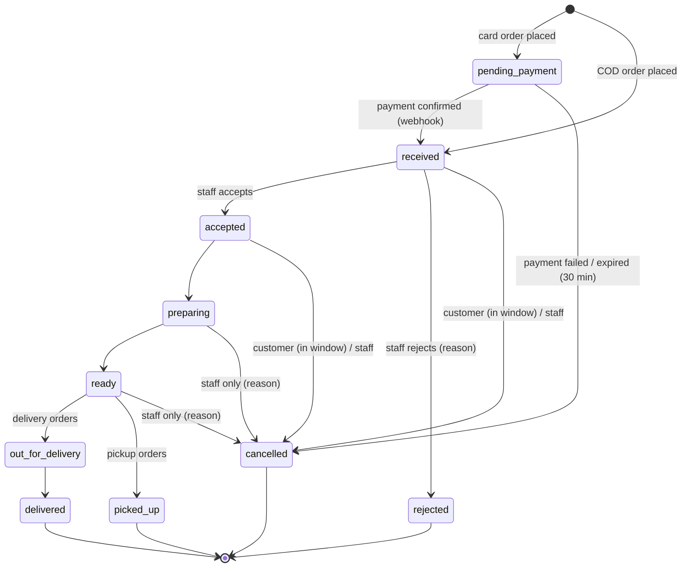

# The Baker — System Design

> Status: **v0.1 draft**, 2026-11-08
> Inputs: [REQUIREMENTS_DRAFT.md](REQUIREMENTS_DRAFT.md) (scope and decisions D1–D8) and [ARCHITECTURE_OVERVIEW.md](ARCHITECTURE_OVERVIEW.md) (stack and conventions).
> Requirement IDs (C1.1, S1.3, O2.1 …) refer to the requirements draft.

---

## 1. Goals

The Baker is an online ordering platform for a fictional bakery in Cairo. Customers order cakes and baked goods for delivery or pickup in a chosen time slot, staff run the order queue, and the owner manages the catalog, capacity and store settings.

**Design goals, in priority order:**

1. **Correct orders.** No overselling of daily capacity or time slots, prices are always computed on the server, and order status changes follow the defined lifecycle.
2. **Accessible to everyone** (D1). WCAG 2.2 AA is a requirement, not an afterthought.
3. **Simple to run.** One repo, one `docker compose up` locally, and Railway (API) + Vercel (web) for the demo.
4. **Easy to extend.** Payments, email and file storage sit behind interfaces, money handling supports any currency, and UI strings are centralized.

---

## 2. Repository layout

A monorepo, as described in ARCHITECTURE_OVERVIEW §5.

```
The-Baker/
├── docker-compose.yml          # db, backend, frontend, mailpit (dev)
├── .env.example
├── README.md                   # setup, demo accounts, architecture links
├── .github/workflows/          # CI with path filters per app
├── backend/
│   ├── alembic/versions/
│   ├── app/
│   │   ├── main.py  database.py  deps.py
│   │   ├── core/               # permissions.py, security.py, money.py, clock.py
│   │   ├── models/  schemas/  crud/  routers/
│   │   ├── services/           # pricing, availability, orders, payments/, notifications/, storage/
│   │   └── tasks/              # expire_unpaid_orders, send_pending_notifications
│   ├── scripts/seed_demo.py
│   └── tests/
├── frontend/
│   └── src/ (lib/, hooks/, components/{auth,layout,ui,common,<feature>}/, pages/<feature>/)
└── docs/
```

---

## 3. Roles and permissions

There are three fixed roles. Permissions live in one config file (`core/permissions.py`) that maps each **module** to the roles allowed to read and write it. Guards are generated from this config and attached in `main.py`.

| Module | Customer | Staff | Owner | Guest |
|---|---|---|---|---|
| `catalog` (public read) | R | R | R | R |
| `checkout` / own orders | RW (own) | — | — | RW (with tracking token) |
| `account` | RW (own) | RW (own) | RW (own) | — |
| `orders_queue` | — | RW | RW | — |
| `catalog_admin` | — | — | RW | — |
| `schedule_admin` (zones, slots, hours, capacity) | — | R | RW | — |
| `settings` (business, policies, payments, templates) | — | — | RW | — |
| `team` | — | — | RW | — |

- **O3.1, "assign roles and permissions":** in v1 the owner assigns a role (`staff` or `owner`) to each team account. Custom per-user permissions are deferred, but the module-based config is designed so a `role_permissions` table can replace the static map later without touching routers.
- The system must always have at least one active owner. The API refuses to demote or deactivate the last one.
- The frontend reads `/auth/me` and hides pages the user can't access. That is for UX only; the server always enforces access.

---

## 4. Domain rules

These rules shape the data model and the services.

### 4.1 Availability and lead time (C2.2, O1.3)

A product variant can be ordered for a fulfilment **date** and **slot** only if all of the following hold:

1. The product is active (`is_available` and not archived) and the variant is active.
2. The store is open that day: an `opening_hours` row exists, the day is not closed, and there is no `store_closures` row for that date.
3. The product is available on that weekday (`product_availability` rules, which default to every day).
4. **Lead time:** `slot_start ≥ now + max(lead_time_hours of all items in the cart)`.
5. **Product daily capacity:** `reserved_qty + requested_qty ≤ daily_capacity` for that product and date. A null capacity means unlimited.
6. **Slot capacity:** `reserved_orders + 1 ≤ max_orders` for that slot and date.

Dates and times are calculated in the store timezone (`Africa/Cairo`). Timestamps are stored in UTC. All "now" logic goes through `core/clock.py` so tests can freeze time.

### 4.2 Capacity reservation (no overselling)

Capacity is held in counter rows that are locked inside the order transaction:

```
product_daily_usage (product_id, date, reserved_qty)     UNIQUE(product_id, date)
slot_daily_usage    (time_slot_id, date, reserved_orders) UNIQUE(time_slot_id, date)
```

When an order is placed, the service:

1. Upserts the counter rows (`INSERT … ON CONFLICT DO NOTHING`).
2. Runs `SELECT … FOR UPDATE` on them, **in a fixed order** (by product id, then slot id) to avoid deadlocks.
3. Checks the limits, increments the counters and inserts the order, **all in one transaction**.

Cancellation, rejection and payment timeout give the capacity back in the same transaction as the status change. A test places concurrent orders for the last unit to prove that only one succeeds.

### 4.3 Pricing (C2.3)

Totals are always calculated on the server by `services/pricing.py`. The client never sends prices.

```
line_total   = variant.price × quantity
subtotal     = Σ line_total
delivery_fee = zone.fee if fulfilment == delivery else 0
total        = subtotal + delivery_fee
```

- A delivery order is rejected if `subtotal < zone.min_order_amount`, with a clear message showing how much more is needed.
- Order items **snapshot** the product name, variant name and unit price, so later catalog edits never change past orders.

### 4.4 Cancellation and modification window (C3.3, O2.1)

The owner sets `cancellation_window_hours` (default 24). The customer can cancel or modify an order only if:

- its status is `received` or `accepted` (preparation has not started), **and**
- `now ≤ slot_start − cancellation_window_hours`.

The API computes this as `order.can_modify_until` and returns it, so the UI shows a countdown ("You can change this order until Tue 14:00") instead of making the customer guess.

**What can be modified:**

| Order | Can change |
|---|---|
| Cash on delivery | Items and quantities, date/slot, address, notes. The order is re-quoted and capacity is re-reserved. |
| Card (paid) | Date/slot, address within a zone with the same fee, notes. Changing items requires cancel and re-order, which avoids partial charges. |

### 4.5 Refunds (O2.1)

The owner chooses a refund policy: `full`, `percentage` (e.g. 80%), or `none` for customer cancellations inside the window. The policy text is shown at checkout and on the order page.

- **Staff rejection or staff cancellation:** always a full refund.
- Refunds go through the payment provider (§7), and the result is recorded in `payments.refunded_amount`.

---

## 5. Data model

### 5.1 Entity overview



All tables follow the conventions: integer `id` primary keys, `created_at` / `updated_at` with server defaults, explicit `ondelete` on every foreign key, and an index on every foreign key.

### 5.2 Tables

**Identity**

| Table | Key columns |
|---|---|
| `users` | `email` (unique, case-insensitive), `password_hash`, `full_name`, `phone`, `role` enum(`customer`,`staff`,`owner`), `is_active`, `last_login_at` |
| `password_reset_tokens` | `user_id` → users (CASCADE), `token_hash` (unique), `expires_at`, `used_at` |
| `addresses` | `user_id` → users (CASCADE), `label`, `zone_id` → delivery_zones (RESTRICT), `street`, `building`, `floor`, `apartment`, `landmark`, `notes`, `is_default` |

**Catalog**

| Table | Key columns |
|---|---|
| `categories` | `name`, `slug` (unique), `description`, `sort_order`, `is_archived` |
| `occasions` | `name`, `slug` (unique), `sort_order`, `is_archived` (e.g. Birthday, Wedding, Ramadan & Eid, Corporate) |
| `products` | `category_id` → categories (RESTRICT), `name`, `slug` (unique), `description`, `ingredients`, `lead_time_hours`, `daily_capacity` (nullable), `is_available`, `is_archived`, `is_featured` |
| `product_variants` | `product_id` (CASCADE), `name` ("6-inch, serves 8"), `price` (int, minor units), `sort_order`, `is_active` |
| `product_images` | `product_id` (CASCADE), `storage_key` (unique), **`alt_text` (NOT NULL)**, `sort_order`. The public URL is computed from the key and the storage settings, so moving the bucket domain needs no data migration. |
| `product_occasions` | `product_id`, `occasion_id` (composite PK, CASCADE) |
| `product_availability` | `product_id` (CASCADE), `weekday` 0–6, `is_available`. No rows means available every day. |

Archiving is a soft delete. Archived products disappear from the storefront but remain on past orders.

**Schedule and delivery**

| Table | Key columns |
|---|---|
| `opening_hours` | `weekday` (unique), `opens_at`, `closes_at`, `is_closed` |
| `store_closures` | `date` (unique), `reason` (holidays, one-off closures) |
| `time_slots` | `weekday`, `starts_at`, `ends_at`, `fulfilment_type` enum(`delivery`,`pickup`,`both`), `max_orders`, `is_active` |
| `delivery_zones` | `name` (e.g. Maadi, Zamalek, New Cairo), `fee`, `min_order_amount`, `is_active`, `sort_order` |
| `product_daily_usage` | `product_id`, `date`, `reserved_qty`, unique(`product_id`,`date`) |
| `slot_daily_usage` | `time_slot_id`, `date`, `reserved_orders`, unique(`time_slot_id`,`date`) |

**Orders**

| Table | Key columns |
|---|---|
| `orders` | `code` (unique, public, e.g. `BK-7F3K2Q`), `user_id` → users (SET NULL, nullable for guests), `contact_name`, `contact_email`, `contact_phone`, `fulfilment_type`, `fulfilment_date`, `time_slot_id` (SET NULL) plus `slot_starts_at` / `slot_ends_at` snapshots, `zone_id` (SET NULL) plus `zone_name` and `delivery_address` snapshots, `subtotal`, `delivery_fee`, `total`, `currency`, `payment_method` enum(`card`,`cod`), `payment_status` enum(`unpaid`,`pending`,`paid`,`partially_refunded`,`refunded`,`failed`), `status` (§6), `is_delayed`, `delay_note`, `rejection_reason`, `cancellation_reason`, `customer_notes`, `tracking_token_hash`, `placed_at` |
| `order_items` | `order_id` (CASCADE), `product_id` / `variant_id` (SET NULL), `product_name`, `variant_name`, `unit_price`, `quantity`, `line_total`, `inscription` (message on the cake) |
| `order_status_events` | `order_id` (CASCADE), `from_status`, `to_status`, `actor_user_id` (SET NULL), `reason`, `created_at`. This powers the customer tracking timeline. |
| `order_messages` | `order_id` (CASCADE), `author_id` (SET NULL), `channel` enum(`email`,`note`), `body`, `sent_at` |

**Payments and notifications**

| Table | Key columns |
|---|---|
| `payments` | `order_id` (CASCADE), `provider` (`stripe`,`cod`), `provider_ref` (e.g. Checkout Session id, unique), `amount`, `refunded_amount`, `status`, `failure_reason` |
| `processed_webhook_events` | `provider`, `event_id`, unique together, so each webhook event is handled once |
| `notifications` | `order_id` (SET NULL), `template_key`, `to_email`, `subject`, `body`, `status` enum(`pending`,`sent`,`failed`), `attempts`, `last_error`, `sent_at`. This is an outbox. |
| `notification_templates` | `key` (unique: `order_confirmed`, `order_accepted`, `order_rejected`, `status_changed`, `order_delayed`, `order_cancelled`, `order_modified`, `password_reset`, `staff_message`), `subject`, `body`, `is_active` |

**Settings (single row)**

`store_settings`: `business_name`, `phone`, `whatsapp`, `email`, `address`, `pickup_location`, `pickup_instructions`, `timezone`, `currency`, `cancellation_window_hours`, `refund_policy` enum, `refund_percentage`, `refund_policy_text`, `card_enabled`, `cod_enabled`, `cod_max_total` (nullable).

**Payment secrets are never stored in the database.** API keys and webhook secrets come from environment variables. The owner's settings screen only switches methods on and off and shows whether each provider is configured.

### 5.3 Money

- Amounts are stored as **integers in minor units**: piastres for EGP. Floats are never used.
- `core/money.py` holds a currency table `{EGP: 2, USD: 2, …}` with each currency's number of decimal places for formatting and parsing. The frontend formats amounts with `Intl.NumberFormat`.
- Choosing a currency is a store setting, so switching currency is a configuration change, not a code change.

### 5.4 Indexes (beyond foreign keys)

| Index | Serves |
|---|---|
| `orders (fulfilment_date, status)` | Staff queue filtered by date and status (S1.1) |
| `orders (user_id, placed_at DESC)` | Order history (C4.3) |
| `orders (status, placed_at)` partial `WHERE status = 'pending_payment'` | Payment-expiry job |
| `products (category_id, is_archived, is_available)` | Menu browsing |
| GIN trigram on `products.name`, `products.description` | Menu search with `ILIKE` (C1.1) |
| `notifications (status, created_at)` partial `WHERE status = 'pending'` | Outbox worker |

---

## 6. Order lifecycle

### 6.1 State machine



- The transitions are defined once, as a table in `services/orders.py`, as `(from, to, allowed_roles, fulfilment_type)`. Both the API and the UI read from this table: the staff UI only shows buttons for the transitions that are allowed next.
- An invalid transition returns `409 Conflict`.
- **Delayed** (S1.5) is a flag (`is_delayed` + `delay_note`), not a status, because an order can be delayed in any active status. Setting it notifies the customer.
- Every transition writes an `order_status_events` row and puts the matching notification in the outbox.
- `rejected` and `cancelled` give capacity back (§4.2) and trigger a refund if the order was paid (§4.5).

### 6.2 Typical flows

**Card checkout (C2.4, C3.1)**

```
Client                      API                                   Stripe
  │ POST /checkout/quote ──▶ validate + price                       │
  │ ◀── totals / errors                                             │
  │ POST /orders (Idempotency-Key) ──▶ tx: reserve capacity,        │
  │                              create order(pending_payment)      │
  │                              create Checkout Session ─────────▶│
  │ ◀── { redirect_url }                                            │
  │ ─────────────────────────── pay on Stripe page ───────────────▶│
  │                              ◀── webhook checkout.session.completed
  │                              verify signature, dedupe event,
  │                              payment=paid, status=received,
  │                              outbox: order_confirmed email
  │ /checkout/success?code=… ──▶ GET /orders/{code} (polls until received)
```

**Cash on delivery:** the order is created directly in `received` with `payment_status = unpaid`. Staff mark it paid when it's delivered or picked up.

**Guest tracking (D7):** when an order is placed, a random 32-byte token is generated. Only its hash is stored. The confirmation email links to `/track/{code}?t={token}`. Logged-in customers can see their own orders without a token.

---

## 7. Integrations

All integrations sit behind small interfaces in `services/`, with a fake implementation used by tests and local development.

| Interface | Methods | Production | Dev / test |
|---|---|---|---|
| `PaymentProvider` | `create_payment(order) → redirect_url`, `parse_webhook(req) → event`, `refund(payment, amount)` | `StripeProvider` (Checkout, **test mode**, D3) | `FakeProvider` |
| `CashOnDelivery` | same interface, no-op redirect | built-in | built-in |
| `EmailSender` | `send(to, subject, html, text)` | Resend (HTTP API) | Mailpit container / console |
| `FileStorage` | `put(file) → key,url`, `delete(key)` | S3-compatible bucket (Cloudflare R2), because managed hosts have temporary disks (D8) | local disk |

- **Stripe and Egypt:** Stripe does not onboard Egyptian merchants, so Stripe is a test-mode demo. A local provider such as Paymob would be added as another `PaymentProvider`, with no changes to the order logic.
- **Webhooks** check the signature, deduplicate through `processed_webhook_events`, and are safe to receive more than once.
- **Emails** are written to the `notifications` outbox inside the business transaction, then sent by a background task that retries with backoff. A failed email never rolls back an order, and the owner can see failures.
- **Templates** use Jinja2 in a sandboxed environment with a whitelist of variables (`{{ order.code }}`, `{{ customer.name }}`, `{{ order.total }}`, `{{ tracking_url }}` …). The owner edits them with a live preview.

**Background tasks** (in-process, single worker, as in ARCHITECTURE_OVERVIEW §7):

- `expire_unpaid_orders`: every minute, cancels `pending_payment` orders older than 30 minutes and gives their capacity back.
- `send_pending_notifications`: every 15 seconds, processes the outbox.

Both use `SELECT … FOR UPDATE SKIP LOCKED`, so they stay safe if we scale to several workers later.

---

## 8. API

REST under `/api/v1`, JSON, JWT bearer auth. Every list endpoint is paginated with the standard envelope `{items, total, page, page_size, total_pages}`, and `page_size` is limited to 100. Errors use one shape: `{error: {code, message, fields?}}`.

### 8.1 Public and customer

| Method | Path | Auth | Req |
|---|---|---|---|
| POST | `/auth/register` · `/auth/login` | — | C4.1 |
| POST | `/auth/forgot-password` · `/auth/reset-password` | — | C4.1 |
| GET | `/auth/me` | user | — |
| PATCH | `/me` | user | C4.2 |
| GET/POST/PATCH/DELETE | `/me/addresses[/{id}]` | user | C4.2 |
| GET | `/me/orders` | user | C4.3 |
| GET | `/store` | — | Business info, hours, pickup details, policy text |
| GET | `/categories` · `/occasions` · `/delivery-zones` | — | C1.1 |
| GET | `/products?category=&occasion=&q=&sort=&page=` | — | C1.1 |
| GET | `/products/{slug}` | — | C1.2 |
| GET | `/availability/dates?variant_ids=` | — | Earliest date and open dates for the next 30 days |
| GET | `/availability/slots?date=&fulfilment=&variant_ids=` | — | Slots with remaining capacity and the reason any slot is unavailable |
| POST | `/checkout/quote` | optional | C2.3 |
| POST | `/orders` | optional (guest OK) | C2.1–C2.4 |
| GET | `/orders/{code}` | owner of the order, or `?t=` token | C3.2 |
| PATCH | `/orders/{code}` | owner of the order, or token | C3.3 |
| POST | `/orders/{code}/cancel` | owner of the order, or token | C3.3 |
| POST | `/payments/stripe/webhook` | Stripe signature | C2.4 |

### 8.2 Staff (`orders_queue`)

| Method | Path | Req |
|---|---|---|
| GET | `/staff/orders?date=&status=&fulfilment=&q=&page=` | S1.1 |
| GET | `/staff/orders/summary?date=` | Counts by status for the queue tabs |
| GET | `/staff/orders/{id}` | S1.1 |
| POST | `/staff/orders/{id}/accept` · `/reject {reason}` | S1.2 |
| POST | `/staff/orders/{id}/transition {to}` | S1.3 |
| POST | `/staff/orders/{id}/delay {note}` · `/cancel {reason}` | S1.5 |
| POST | `/staff/orders/{id}/messages {body}` | S1.4: emails the customer and logs the message |
| POST | `/staff/orders/{id}/mark-paid` | Cash collected |
| GET | `/staff/prep-sheet?date=` | Quantity of each product needed for the day (supports capacity planning) |

### 8.3 Owner (`catalog_admin`, `schedule_admin`, `settings`, `team`)

| Resource | Endpoints | Req |
|---|---|---|
| Categories / occasions | CRUD + `POST …/{id}/archive` · `/restore` | O1.1 |
| Products | CRUD + archive/restore, `PUT /admin/products/{id}/availability` | O1.1, O1.3 |
| Variants | `POST/PATCH/DELETE /admin/products/{id}/variants[/{vid}]` | O1.1 |
| Images | `POST /admin/products/{id}/images` (multipart, alt text required), `PATCH` reorder/alt, `DELETE` | O1.2 |
| Delivery zones | CRUD | D6 |
| Schedule | `PUT /admin/opening-hours`, CRUD `/admin/time-slots`, CRUD `/admin/closures` | O1.3, O4.1 |
| Settings | `GET/PATCH /admin/settings` (business, pickup, policies, payment toggles) | O2.1, O4.1, O4.2, O4.4 |
| Templates | `GET /admin/notification-templates`, `PATCH /{key}`, `POST /{key}/preview` | O4.3 |
| Team | `GET/POST /admin/team`, `PATCH /{id}` (role, active), `DELETE /{id}` (deactivates the account) | O3.1 |
| Notifications | `GET /admin/notifications?status=failed`, `POST /{id}/retry` | Operations |

### 8.4 Cross-cutting

- **Idempotency:** `POST /orders` requires an `Idempotency-Key` header, so a double click or a retry never creates two orders.
- **Rate limits** (slowapi): login, register, forgot-password, quote and order creation.
- **Caching:** a TTL + single-flight cache on `/categories`, `/occasions`, `/delivery-zones` and `/store`, placed below the auth layer and cleared when an admin writes. Product lists are not cached in v1.

---

## 9. Frontend

### 9.1 Routes

| Area | Route | Page | Req |
|---|---|---|---|
| Store | `/` | Home: featured items, categories, occasions | C1.1 |
| | `/menu?category=&occasion=&q=` | Menu with filters and debounced search | C1.1 |
| | `/products/:slug` | Product detail: gallery, size picker, price, ingredients, earliest date | C1.2 |
| | `/cart` | Cart: edit quantities and inscriptions | C2.1 |
| | `/checkout` | Step 1 fulfilment & zone → 2 date & slot → 3 contact & address → 4 payment → 5 review | C2.2–C2.4 |
| | `/checkout/success` · `/checkout/cancelled` | Result pages | C3.1 |
| | `/track/:code` | Status timeline, can-modify countdown, cancel/modify | C3.2, C3.3 |
| | `/accessibility` · `/policies` | Accessibility statement, refund and cancellation policy | D1, O2.1 |
| Auth | `/login` · `/register` · `/forgot-password` · `/reset-password` | | C4.1 |
| Account | `/account` · `/account/addresses` · `/account/orders` · `/account/orders/:code` | | C4.2, C4.3 |
| Staff | `/staff/orders` | Queue: date picker, status tabs with counts, refreshes every 30 s | S1.1 |
| | `/staff/orders/:id` | Order detail, allowed actions, contact panel (email, tel:, WhatsApp) | S1.2–S1.5 |
| | `/staff/prep-sheet` | Printable daily production list | — |
| Owner | `/admin/products[/new | /:id]` · `/admin/categories` · `/admin/occasions` | | O1.1–O1.3 |
| | `/admin/schedule` | Opening hours, time slots, closures | O1.3, O4.1 |
| | `/admin/delivery-zones` · `/admin/policies` · `/admin/settings` · `/admin/templates` · `/admin/team` | | O2–O4 |

Route guards in `App.tsx` are `RequireAuth`, `GuestOnly`, and `RequireModule("orders_queue")`.

### 9.2 State

- **Cart:** stored on the client (React context + `localStorage`) as `{variant_id, quantity, inscription}`. Prices shown in the cart come from `/checkout/quote`, never from the client. This works the same for guests and signed-in users.
- **Checkout:** state is kept per step in one reducer. The "Continue" button calls `/checkout/quote`, so errors (slot full, below minimum order, lead time) appear on the step that caused them.
- Server data is held in page-level hooks (`useProducts`, `useOrder`) with an AbortController to cancel stale requests. There is no global store, as in ARCHITECTURE_OVERVIEW §3.

---

## 10. Accessibility (WCAG 2.2 AA, D1)

### 10.1 Commitments

| Area | What we do | WCAG |
|---|---|---|
| Structure | Semantic landmarks, one `h1` per page, logical heading order, skip link | 1.3.1, 2.4.1, 2.4.6 |
| Keyboard | Every action works by keyboard. Modals and drawers trap focus and return it on close. No keyboard traps. | 2.1.1, 2.1.2 |
| Focus | Visible focus ring (≥ 3:1 contrast) that is never hidden by the sticky header or cart bar | 2.4.7, 2.4.11 |
| Targets | Interactive targets are ≥ 24×24 px, and ≥ 44 px for primary actions | 2.5.8 |
| Contrast | Text ≥ 4.5:1 and UI components ≥ 3:1, enforced through design tokens | 1.4.3, 1.4.11 |
| Not colour alone | Status badges use an icon and text as well as colour. Errors use an icon and text. | 1.4.1 |
| Images | **Alt text is required at upload** (enforced by the API), and decorative images use `alt=""` | 1.1.1 |
| Forms | Visible labels, `autocomplete` attributes, inline errors linked with `aria-describedby`, and an error summary at the top of each checkout step | 1.3.5, 3.3.1, 3.3.3 |
| Redundant entry | Saved addresses and contact details are prefilled, and checkout steps never ask for the same thing twice | 3.3.7 |
| Accessible authentication | Pasting and password managers are allowed, there are no CAPTCHA puzzles, and there is a show-password toggle | 3.3.8 |
| Live updates | `aria-live="polite"` for cart changes, quote totals and the staff queue's new-order count | 4.1.3 |
| Date and slot picking | Slots are a native radio group with the time as text, not a calendar that only works with a pointer | 2.5.7 |
| Consistent help | The contact (phone/WhatsApp) link is always in the same place in the footer and header | 3.2.6 |
| Motion | `prefers-reduced-motion` is respected and nothing auto-plays | 2.3.3 |
| Reflow | Works at 320 px width and at 200–400% zoom with no horizontal scroll | 1.4.4, 1.4.10 |

### 10.2 Display preferences

A "Display" menu in the header offers **text size** (100 / 125 / 150%), **high contrast**, and **reduce motion**. These are CSS custom-property themes on `<html>`, saved in `localStorage`.

### 10.3 Verification

- **Lint:** `eslint-plugin-jsx-a11y`.
- **Automated:** `@axe-core/playwright` runs on every key page in CI, and the build fails on any serious or critical violation.
- **Manual:** keyboard-only and VoiceOver passes through the golden paths (browse → order → track; staff queue; add a product), recorded in `docs/ACCESSIBILITY_AUDIT.md`.
- **Lighthouse:** an accessibility score of at least 95 on the storefront pages.

### 10.4 RTL readiness

Tailwind logical utilities (`ms-`, `me-`, `ps-`, `start-`), `dir` set on `<html>`, and all UI strings in `src/lib/strings.ts`. Adding Arabic means adding translations, not changing the layout.

---

## 11. Security

- Passwords are hashed with bcrypt, and the minimum length is 10 characters.
- The JWT access token lasts 60 minutes and inactive users are rejected.
- Password reset tokens are random, only their hash is stored, they last 30 minutes and work once. The endpoint returns the same response whether or not the email exists.
- Guest tracking tokens: only the hash is stored, and they are compared in constant time.
- Prices, totals, capacity and allowed transitions are always decided on the server.
- The Stripe webhook signature is verified, and duplicate events are ignored.
- Uploads are checked by MIME type and magic bytes (JPEG/PNG/WebP), limited to 5 MB, and re-encoded with Pillow to strip EXIF data.
- CORS allows only the frontend origin. Secrets come only from environment variables. `.env` files are ignored by git and `.dockerignore`.
- Staff and owner pages are never cached, and user data endpoints send `Cache-Control: no-store`.

---

## 12. Testing

| Level | Tooling | Focus |
|---|---|---|
| Unit | pytest | Pricing, money formatting, availability rules, the state-machine table, the cancellation window (with frozen time) |
| Integration | pytest + test Postgres (compose) + httpx | Every router: auth guards for each role, pagination, validation errors |
| Concurrency | pytest + asyncio.gather | Last-unit capacity and last-slot races, and double-submit with the same idempotency key |
| Payments | FakeProvider and Stripe CLI fixtures | Webhook handled once, payment expiry, refunds |
| Frontend unit | Vitest + Testing Library | Cart reducer, checkout step validation, display preferences |
| End-to-end | Playwright + axe | Guest card checkout, COD checkout, staff moves an order to delivered, owner adds a product |

CI runs on GitHub Actions with path filters (`backend/**`, `frontend/**`).

---

## 13. Deployment and demo (D2, D8)

| Piece | Local | Demo |
|---|---|---|
| Database | `postgres:16-alpine` in compose | **Railway** Postgres, in the same project as the backend |
| Backend | compose service, self-migrating entrypoint | **Railway** service built from `backend/Dockerfile` (root directory `backend/`), health check at `/healthz` |
| Frontend | compose nginx | **Vercel** project (root directory `frontend/`, Vite preset) |
| Email | Mailpit (web UI on :8025) | Resend |
| Files | local volume | Cloudflare R2 bucket |
| Payments | FakeProvider or Stripe test | Stripe test mode + webhook endpoint on the Railway domain |

```
Browser ──▶ Vercel (static SPA, CDN)
   │
   └── fetch + Bearer JWT ──▶ Railway: FastAPI ──▶ Railway Postgres
                                   ▲    │
              Stripe webhooks ─────┘    ├──▶ Resend (email)
                                        └──▶ R2 (product images)
```

### 13.1 Railway (backend + database)

- The entrypoint runs `alembic upgrade head`, seeds the first owner from env vars, runs the optional demo seed, and then starts `uvicorn` on `$PORT`. Running it again on a restart is safe.
- **`DATABASE_URL`** comes from Railway's Postgres service. `app/database.py` rewrites the scheme to `postgresql+asyncpg://` for the async engine and `postgresql+psycopg://` for the sync batch engine.
- The pool size is set explicitly to fit the Railway Postgres connection limit, as in ARCHITECTURE_OVERVIEW §2.
- There is **one replica**, because background tasks and the TTL cache run in-process (§7). The tasks already use `SKIP LOCKED`, so moving the cache to Redis is the only change needed to scale out.
- Secrets are set as Railway variables: `JWT_SECRET`, `STRIPE_SECRET_KEY`, `STRIPE_WEBHOOK_SECRET`, `RESEND_API_KEY`, `R2_*`, `FRONTEND_URL`, `CORS_ORIGINS`.

### 13.2 Vercel (frontend)

- `VITE_API_URL` is set in Vercel's environment variables and baked into the bundle at build time. It points to the Railway public domain.
- `frontend/vercel.json` adds the SPA rewrite (`/(.*) → /index.html`) and cache headers: `no-cache` on `index.html` and `immutable` on `/assets/*`. These replace what nginx does locally.
- **Preview deployments:** every pull request gets a Vercel preview URL. `CORS_ORIGINS` lists the production domain, and an optional `CORS_ORIGIN_REGEX` allows `https://the-baker-*.vercel.app` previews against the demo API.

### 13.3 Cross-origin notes

- The frontend and API are on different domains. Auth uses a **Bearer token in a header, not cookies**, so there are no third-party-cookie or `SameSite` problems, and CSRF does not apply.
- Stripe's `success_url` and `cancel_url`, and the tracking links in emails, are built from `FRONTEND_URL` (Vercel). The webhook URL is the Railway domain.
- The same Docker Compose stack is still used for local development and CI, so nothing depends on the hosting platform.

**Seeded demo** (`scripts/seed_demo.py`, idempotent):

- About 30 products in 6 categories (Celebration Cakes, Cupcakes, Breads, Pastries, Cookies, Seasonal), with occasions such as Birthday, Wedding, Ramadan & Eid, and Corporate.
- Delivery zones across Cairo and Giza: Maadi, Zamalek, Heliopolis, Nasr City, New Cairo, Sheikh Zayed.
- Opening hours, two-hour slots, and a few sample orders in every status.
- Demo accounts `customer@demo.thebaker`, `staff@demo.thebaker` and `owner@demo.thebaker`, listed in the README and on a login hint panel shown only in demo mode.
- A banner: "Demo store, no real orders. Use card 4242 4242 4242 4242."
- An optional nightly reset job so the demo stays clean.

---

## 14. Delivery plan

Each milestone is one or more pull requests with tests. The demo is updated at the end of each milestone.

| # | Milestone | Covers |
|---|---|---|
| M0 ✅ | Scaffolding: monorepo, compose, CI, design tokens and a11y lint, auth (register, login, reset, me), and a **first deploy to Railway + Vercel**, so every later milestone ships to a live URL | C4.1, D8 |
| M1 ✅ | Catalog: public menu, search, product page, and owner CRUD with images | C1, O1.1, O1.2 |
| M2 | Schedule and zones: hours, slots, closures, capacity, availability endpoints | O1.3, D6 |
| M3 | Cart, quote, checkout, COD orders, capacity reservation | C2 |
| M4 | Stripe test payments, webhooks, outbox emails, templates | C2.4, C3.1, O4.2, O4.3 |
| M5 | Staff queue, lifecycle, delay/cancel, contact, prep sheet | S1 |
| M6 | Tracking, modify/cancel window, refunds, account pages | C3, C4.2, C4.3, O2 |
| M7 | Team management, settings, accessibility audit, demo seed, deploy, README polish | O3, O4, D1, D2 |

---

## 15. Resolved questions

| # | Question | Answer | Decision |
|---|---|---|---|
| 1 | Time slot shape | Fixed two-hour windows, each with a maximum number of orders, for both delivery and pickup | D9 |
| 2 | Product options | Sizes (variants) plus a free-text cake message only. No flavour or filling add-ons in v1. | D10 |
| 3 | Market | Stays in Egypt (EGP). Another currency is possible later through configuration (§5.3). | D4 |
| 4 | Hosting | Backend and Postgres on Railway, frontend on Vercel (§13) | D8 |

No open questions remain.
